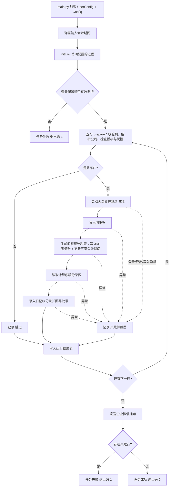

# JDE 印花税 RPA 程序说明文档

编写日期：2026-11-18。本文依据当前工作区（`taiguhui_stamp_tax`）源代码编写，面向使用、运维及后续开发人员；功能描述以代码实现为准。本程序以 `taiguhui-jde-flow-main`（房产税流程）为参考框架，复用其中的配置、任务、日志、浏览器、JDE 页面操作与运行结果通知等模块，新增印花税业务实现；参考包本身未做任何改动。

## 0. 与房产税流程的关系

| 项目 | 房产税流程 | 本程序（印花税） |
| --- | --- | --- |
| JDE 登录 | `login_task.py` | 直接复用 |
| 明细账导出 | `jde_function.download_gl_movement` | 直接复用 |
| 日记帐分录录入 | `jde_function.create_journal_entry` | 直接复用 |
| 配置/日志/浏览器/结果通知 | `config`、`core`、`log`、`web`、`run_report` | 复制复用，仅改配置页名与报表名称 |
| 计税表生成 | 房产税标题定义文件 + 明细账写入 | 改为动态标题映射写入模板 `JDE明细账` 页 |
| 底稿更新 | R55GL1005 重建、Check 汇总、审核与申报底稿 | 本流程不需要，改为「更新三个页签的会计期间」 |
| 核对 | COM 重算 + 多项金额核对 | 本流程不需要 |
| 输出文件 | `房产税计税表 公司 YYYYMM.xlsx` | `印花税计税表 公司 YYYYMM.xlsx` |
| 结果表 | `房产税计税表更新与分录录入运行结果表-{年}.xlsx` | `印花税计税表运行结果表-{年}.xlsx` |

## 1. 程序概述

本项目使用 Python 开发，通过 Playwright 操作 JDE 网页，通过 openpyxl 读写工作簿，通过 Windows COM（Excel）写入模板、重算公式并读取公式结果。

单行业务链路：

```text
读取配置 → 会计期间弹窗 → 初始化环境 → 启动浏览器 → 登录 JDE →
导出明细账 → 生成印花税计税表（按标题写入 JDE明细账 页 + 更新三个页签会计期间）→
按四标题读取计算底稿分录区 → 录入 JDE 日记帐分录 → 回写批号到三个页签 →
关闭浏览器/Excel → 写入运行结果表 → 企业微信通知
```

### 1.1 当前实现范围

| 模块 | 能力 | 实现状态 |
| --- | --- | --- |
| 一：登录 JDE | 按行读取 Windows 通用凭据，填写环境、角色并登录 | 已实现（复用） |
| 二：导出明细账 | 按科目帐的帐户查询，按会计期间自然月导出明细账 | 已实现（复用） |
| 三：生成计税表 | 复制共享盘模板，按标题把明细账写入模板 `JDE明细账` 页；同一次 Excel 会话中把 `印花税计算底稿`、`租赁`、`收入类` 三页的「会计期间：」写为期间首日 | 已实现 |
| 四：分录录入 | 按「账号 / 借项金额 / 贷项金额 / 备注」动态定位计算底稿分录区，整块粘贴到 JDE 日记帐分录，并把批号回写到三个页签「批号：」右侧单元格 | 已实现（分录取消不保存，见 5.8） |
| 批量调度 | 按「登录配置」逐行运行、逐行写结果表、全部结束后发送企业微信通知 | 已实现（复用） |

> 分录录入沿用 JDE 模块的联调行为：完成增加、填写表头、校验列顺序与粘贴后，点击「取消」退出且**不保存**。正式启用前需按 5.8 的说明调整保存逻辑。

## 2. 项目结构与职责

```text
项目根目录/
├── main.py                         流程入口（加载配置、会计期间弹窗、初始化、主任务）
├── run.bat                         Windows 启动脚本（优先使用 .venv）
├── requirements.txt                Python 依赖清单
├── 程序说明文档.md                  本文档
├── config/
│   ├── config.py                   配置合并、目录生成与配置归档
│   └── config_loader.py            Excel 配置读取、多行配置、ConfigError
├── core/
│   ├── task_base.py                任务执行、日志、状态与耗时管理
│   └── context.py                  共享配置、业务数据与浏览器实例
├── workflows/jde_flow/
│   ├── main_task.py                逐行编排、逐行参数、结果表与通知
│   ├── login_task.py               获取凭据并执行登录
│   ├── stamp_tax.py                印花税主流程（导出、写模板、更新期间、分录、批号回写）
│   ├── excel_com.py                Excel COM 会话写入、重算、保存与 openpyxl 降级
│   └── run_report.py               运行结果表与企业微信通知
├── web/
│   ├── browser.py                  Playwright 浏览器封装
│   └── JDE/jde_function.py         JDE 登录、明细账导出、日记帐分录录入
├── utils/
│   ├── credentials.py              Windows 通用凭据读取
│   ├── period_dialog.py            会计期间输入弹窗
│   └── helpers.py                  时间戳、目录、耗时格式化
├── init/init.py                    进程清理
├── log/loggingConfig.py            日志初始化（控制台 + log_data）
├── data/                           Config.xlsx、UserConfig.xlsx
├── docs/                           需求整理与印花税模板样例
└── tests/test_stamp_tax.py         纯逻辑单元测试
```

运行时目录（`基础路径/项目名称/…`，默认 `./data/印花税流程/…`）：

```text
01_配置/          两个配置工作簿的归档副本
02_输入/          未指定 模板文件 时用于查找唯一模板
03_输出/          明细账等中间结果；按行创建「公司简称 公司代码 YYYYMM」数据目录
04_日志/          年度运行结果表
05_错误截图/      失败截图
06_临时文件/      预留
log_data/         业务日志（相对进程工作目录）
```

## 3. 环境与安装

### 3.1 运行条件

- Windows 桌面环境：配置弹窗、Windows 通用凭据、COM 调用均依赖 Windows。
- Python 3（开发环境 3.12），可安装 Playwright 与 pywin32。
- 可访问 JDE 系统的网络环境，且当前 Windows 用户已保存所需「通用凭据」。
- 安装 Microsoft Excel（`Excel.Application`）。RPA 通过 Excel 打开模板写入并重算公式；本机无 Excel 时会降级为 openpyxl 写入，但没有公式结果，无法生成分录。
- 共享盘目录可读写：模板与生成表都放在共享盘目录。

### 3.2 依赖

以 `requirements.txt` 为准：`openpyxl>=3.1.0`、`Pillow>=10.0.0`、`psutil>=5.9.0`、`pywin32>=305`、`requests>=2.28.0`、`playwright>=1.40.0`、`uiautomation>=2.0.0`。另需标准库 `tkinter`（会计期间弹窗）。

### 3.3 安装

```powershell
python -m venv .venv
.\.venv\Scripts\Activate.ps1
python -m pip install -r requirements.txt
python -m playwright install chromium
```

## 4. 配置说明

### 4.1 配置文件与加载规则

主入口加载 `data/UserConfig.xlsx`（用户配置）与 `data/Config.xlsx`（系统配置），两个文件都必须存在：

- 普通配置页：第 1 行为标题，第 2 行起 A 列为配置项、B 列为值；C 列说明不读取；B 列为 `None` 的行不载入（视为未配置）。
- 多行配置页（`登录配置`、`通知配置`）：第 1 行为列标题，第 2 行起每行一条记录；全空行跳过；字符串去除首尾空格。
- 同一 `工作表.配置项` 以 `UserConfig.xlsx` 为优先，其余由 `Config.xlsx` 补充。
- 多行配置页在 `UserConfig.xlsx` 中无数据行时，回落到 `Config.xlsx` 的同名页。
- 程序用 `工作表名.配置项` 访问配置，如 `JDE配置.jde_url`、`印花税配置.公司`。
- 启动时把两个配置工作簿复制到 `01_配置/`（仅在目标不存在时复制）。

### 4.2 基础配置与目录配置（UserConfig.xlsx）

| 工作表 | 配置项 | 默认值 | 说明 |
| --- | --- | --- | --- |
| 基础配置 | 项目名称 | `JDE流程` | 当前配置为 `印花税流程`，用于工作目录名称 |
| 基础配置 | 基础路径 | `./data` | 相对路径按配置文件所在目录的上一级（项目根目录）解析 |
| 基础配置 | 初始化进程列表 | 空 | 英文或中文逗号分隔；按进程名**子串匹配**终止进程 |
| 目录配置 | 配置目录 / 输入目录 / 输出目录 / 日志目录 / 截图目录 / 临时目录 | `01_配置` … `06_临时文件` | 见第 2 节目录说明 |

### 4.3 JDE配置（Config.xlsx）

| 配置项 | 必填 | 说明 |
| --- | --- | --- |
| jde_url | 是 | JDE 登录地址；为空时任务启动即失败 |
| jde_credential_name | 是 | Windows 通用凭据目标名称；主流程会被「登录配置」的 `window凭据` 逐行覆盖 |
| jde_environment | 否 | 登录环境，如 `JPD920` |
| jde_role | 否 | 登录角色，如 `*ALL` |
| headless | 否 | 默认 `False`；接受 true/false、1/0、yes/no |

- `JDE_URL`、`JDE_ENVIRONMENT`、`JDE_ROLE` 环境变量会覆盖对应配置值。
- 账号密码不从配置读取：`utils/credentials.py` 通过 `CredRead(CRED_TYPE_GENERIC)` 读取当前 Windows 用户的通用凭据，密码按 UTF-16-LE 解码。

凭据读取结果与处理：

| 情况 | 处理 |
| --- | --- |
| 凭据不存在（WinError 1168） | 该行记为「跳过」，不计入失败 |
| 其他读取失败、用户名/密码为空、编码无效 | 该行记为「失败」 |

「登录配置」的 `凭据账号` 与凭据用户名（去掉域前缀）比较，不一致只记录 warning，仍使用凭据账号登录。

### 4.4 登录配置（多行，主流程入口）

「登录配置」页每一行对应一个账号与一个共享盘目录，程序按行完整跑一遍流程。

| 列名 | 必填 | 说明 |
| --- | --- | --- |
| window凭据 | 是 | Windows 通用凭据目标名称 |
| 凭据账号 | 是 | 与凭据用户名比对，仅用于告警 |
| 共享盘路径 | 是 | 目录绝对路径，末段必须是「公司简称 公司代码」两个词，如 `N:\…\太古汇 2501` |

校验与派生规则：

- 三个必填列任一为空：该行报错并记为失败，其他行继续。
- 共享盘路径末段必须恰好两个词且第二个为纯数字；否则该行失败。
- 公司简称取末段第一个词，用于模板名与生成表文件名。
- 公司代码取末段第二个词并左补零到 5 位（`2501` → `02501`），用于明细账自公司 / 至公司、分录公司与运行结果表，取数与派生方式与 `taiguhui-jde-flow-main` 一致；配置中的 `明细账自公司`、`明细账至公司`、`分录公司` 仅作兜底，运行时都会被本行公司代码覆盖。
- 共享盘目录下必须存在模板 `印花税计税表 {公司简称}.xlsx`，否则该行失败。
- 数据目录为 `输出目录/{公司简称} {公司代码} {YYYYMM}`，每行独立，自动创建。
- 每行执行前写入覆盖项：

| 覆盖键 | 值 |
| --- | --- |
| JDE配置.jde_credential_name | 本行 `window凭据` |
| 印花税配置.公司 | 公司简称 |
| 印花税配置.模板文件 | 共享盘/`印花税计税表 {简称}.xlsx` |
| 印花税配置.输出目录 | 共享盘目录 |
| 印花税配置.明细账自公司 / 至公司 | 5 位公司代码 |
| 印花税配置.分录公司 | 5 位公司代码 |
| 印花税配置.明细账文件 | 数据目录/`JDE明细账 {时间戳}`（无后缀） |

### 4.5 印花税配置（Config.xlsx）

常用业务配置为 `会计期间`、`公司`、`明细账分类帐类型`；其余配置项与 `taiguhui-jde-flow-main`（房产税流程）保持一致，按需覆盖即可。

| 配置项 | 默认值 | 主流程是否覆盖 | 说明 |
| --- | --- | --- | --- |
| 会计期间 | 空 | 由弹窗写入 | 空或仅空格按当月；支持 `YYYY-MM`、`YYYY/MM`、`YYYYMM`、`YYYY年M月` |
| 公司 | 空 | 是 | 文件名用公司简称；不得含 `<>:"/\|?*` 及控制字符 |
| 模板文件 | 空 | 是 | 显式模板路径；相对路径按输入目录解析；主流程固定为共享盘模板 |
| 输出目录 | 空 | 是 | 生成表输出目录；相对路径挂在框架输出目录下；主流程为共享盘目录 |
| 明细账文件 | 空 | 是 | 导出目标；相对路径按输出目录解析；主流程为数据目录下的无后缀名 |
| 明细账工作表 | 空 | 否 | 明细账工作表名；留空取导出文件第一张 |
| 明细账标题行 | `1` | 否 | 必须是正整数 |
| 模板标题行 | `1` | 否 | 模板 `JDE明细账` 页标题所在行，必须是正整数 |
| 标题映射 | 空 | 否 | JSON 对象，方向「源标题 → 模板标题」，覆盖自动匹配结果 |
| 计算底稿工作表 | `印花税计算底稿` | 否 | 更新期间、读取分录区、回写批号使用的工作表 |
| 分录公司 | `02501` | 是 | 分录 Document Company；默认值仅作兜底，主流程取共享盘路径末段的公司代码并左补零到 5 位（`2501` → `02501`），与 `taiguhui-jde-flow-main` 一致 |
| 重算引擎 | `Excel.Application` | 否 | WPS 可尝试 `ket.Application`；`openpyxl` 仅生成表、无公式结果 |
| 明细账分类帐类型 | `AA` | 否 | 明细账查询的分类账类型 |

补充说明：

- 输出文件名统一为 `印花税计税表 公司 YYYYMM.xlsx`，期间取会计期间所在月；同名文件会被**直接覆盖**。
- 「会计期间：」右侧写入的是**本次会计期间首日**（`yyyy/m/d`）。弹窗输入值优先，未输入按当月。
- 明细账导出的起始日期 / 至日期**跟随会计期间**，固定取该期间自然月的首日与末日（`MM/DD/YYYY`），不单独配置。
- 分录的总帐日期取**运行当天**（`MM/DD/YYYY`），不单独配置。
- `计算底稿工作表` 所在页签与 `租赁`、`收入类` 一起，构成需要更新「会计期间：」和「批号：」的三个页签。
- `重算引擎` 设为 `openpyxl` 时不会启动 Excel：模板可正常生成，但公式没有缓存值，读取分录区会失败并提示需要 Excel 重算。

### 4.6 通知配置

`通知配置` 页按「配置项 / 值」两列登记机器人，`WechatRobot1`、`WechatRobot2`… 每项为一个 Webhook 地址；留空则跳过。配置项名称须匹配 `^WechatRobot\d+$`（不区分大小写），按编号排序后依次发送。

## 5. 主流程与业务规则



### 5.1 启动、会计期间弹窗与环境初始化

1. `main.py` 加载 `UserConfig.xlsx` 与 `Config.xlsx`，创建目录并归档配置。
2. 弹出置顶、居中的输入框：
   - 输入合法期间（`2026-10`、`202610`、`2026/10`、`2026年10月`）并确定：写入 `印花税配置.会计期间`。
   - 留空确定、Esc、关闭窗口、60 秒无按键/点击或弹窗无法显示：清空会计期间，按当月运行。
   - 格式非法时红字提示并重置倒计时。
3. `initEnv()` 按「初始化进程列表」关闭进程（子串匹配，例如配置 `excel` 会关闭所有名称含 excel 的进程，启动前请保存数据）。
4. 创建并执行 `JDEMainTask`。

日志同时输出到控制台（stderr）与 `./log_data/YYYYMMDD_机器名.log`。

### 5.2 主任务逐行编排

`JDEMainTask.execute()`：

1. 校验 `JDE配置.jde_url` 非空。
2. 读取「登录配置」数据行；为空时直接失败。
3. 计算本次会计期间标签（`YYYYMM`，空则当月）。
4. 逐行执行，每行开始前清空上下文的 `stamp_tax_status` 与 `jde_journal_batch`。

每行 `prepare()`：校验三个必填列 → 解析公司简称/代码 → 检查共享盘与模板 `印花税计税表 {简称}.xlsx` → 读取 Windows 凭据（不存在抛 `SkipRun`）→ 计算会计期间与数据目录 → 写入 4.4 的覆盖项并打印运行参数。

`run_one()`：新建 `BrowserManager`（`headless` 来自配置）→ 启动 → `JDELoginTask` → `StampTaxFlow.run()`；异常时若页面可用则截图到 `05_错误截图/jde_failure_{简称}_{代码}.png`，最后在 `finally` 中关闭浏览器。

单行结果判定：

| 上下文 `stamp_tax_status` | 运行结果 | 是否计入失败 |
| --- | --- | --- |
| `completed` | 成功 | 否 |
| 未设置 | 成功 | 否 |
| 其他值 | 失败（异常情况写「印花税流程未完成」） | 是 |
| prepare 抛 `SkipRun` | 跳过 | 否 |
| 其他异常 | 失败 | 是 |

每行无论成功、失败还是跳过，都会立即写入运行结果表；全部行处理完后发送通知。只要存在失败行，通知后抛出 `ConfigError("以下账号执行失败：…")`，退出码 1。

### 5.3 登录

- 每次登录最多重试 3 次，间隔 5 秒（`retry_on_failure`），仅包裹登录函数。
- `jde_login()`：打开 `jde_url`；若 `#drop_mainmenu` 5 秒内可见则视为已登录；否则按需点击 `Details`，填写 Environment、Role（非空时）、User ID、Password，点击 `Sign In`，等待主菜单 20 秒。
- 登录成功后 `context.jde_logged_in=True`；浏览器在同行的导出与分录环节复用。

### 5.4 导出明细账

`StampTaxFlow.export_ledger()`：

- 校验 `明细账自公司`、`明细账至公司` 非空，浏览器已打开。
- 日期区间：固定跟随会计期间，取该期间自然月首末日，统一格式化为 `MM/DD/YYYY`。
- 目标文件：`明细账文件`（相对路径按框架输出目录解析）；未配置时输出目录 `/JDE明细账 {时间戳}`；无后缀时按下载建议文件名补后缀。
- 页面操作：选择页面 → 所有页面 → 总帐 → 按科目帐的帐户查询；填写分类账类型 2（默认 `AA`）、自公司、至公司、起始日期、至日期；查找；转到结束；选择所有提取的记录；输出网格数据；本地文件系统 + 输出到 Excel + 新工作簿 + 所有；点击「继续」触发下载（超时 300 秒）并保存。
- 成功后设置上下文 `jde_ledger_path`。

### 5.5 生成印花税计税表

`StampTaxFlow.create_template(ledger_path)`：

1. 模板：`模板文件`（相对输入目录）优先；否则在输入目录查找名称包含「印花税计税表」的 `.xlsx`，排除 `~$` 临时文件与明细账本身，必须唯一。
2. 校验 `公司` 非空且不含文件名非法字符。
3. 期间取会计期间所在月（`YYYYMM`）；输出目录为 `输出目录`（相对路径挂在框架输出目录下）或框架输出目录；输出文件 `印花税计税表 公司 YYYYMM.xlsx`。
4. 输出路径不得与模板或明细账相同；同名输出已存在时删除并覆盖（被 Excel 占用时提示关闭后重试）。
5. `标题映射` 必须是字符串到字符串的 JSON 对象。
6. 标题读取：源表取 `明细账工作表`（默认导出文件第一张）第 `明细账标题行` 行；模板取 `JDE明细账` 页第 `模板标题行` 行；同一行内标题重复直接失败。
7. 标题匹配（`build_header_pairs`）：
   - 先应用 `标题映射`，再按规范化标题自动补齐；规范化会忽略首尾/内部空白、下划线、连字符、`+ / ( )`、全角括号，大小写不区分。
   - 所有源标题都必须映射到模板标题，否则报「明细账标题未映射到模板」。
   - 模板所需标题必须全部有来源，否则报「明细账缺少模板所需标题」。
   - 多个源标题指向同一模板标题失败。
8. 数据行：从标题行下一行开始，跳过全空行；无数据行失败。
9. 写入（`excel_com.write_ledger`）：
   - 复制模板到输出位置，用 Excel COM 打开（保留图表、图片、数据透视表与外部链接）。
   - 只清空映射列的历史数据（按 2000 行分块清空，避免大范围清空在 Excel COM 下静默失效），模板其他列与行格式不动。
   - 逐列写入：纯文本列临时设为文本格式，避免 `00100` 变 `100`；数据行超出模板已有行数时，从首条明细复制格式并同步行高。
   - 同一次会话内把三个页签的「会计期间：」写为期间首日，然后常规重算（不使用 `CalculateFullRebuild`，避免含透视表/外链接的模板报 OLE 错误）并保存。
   - Excel 不可用时降级为 openpyxl 写入（保留其他工作表与样式、回写外部链接部件，设置打开时全量重算），并记录 warning。
10. 保留 Excel 会话供后续回写批号；设置上下文 `stamp_tax_path`、`jde_ledger_rows`、`jde_ledger_mapping`。

### 5.6 更新「会计期间：」

- 三个页签：`计算底稿工作表`（默认 `印花税计算底稿`）、`租赁`、`收入类`，布局见 `docs/印花税 2026 10.xlsx`。
- 不写死单元格：在每个页签的已使用区域内按**单元格文字**动态查找「会计期间：」，取第一个匹配的标签，把它右侧的第一个单元格写为期间首日，数字格式 `yyyy/m/d`。
- 标签本身属于合并区域时，写入合并区右侧第一个单元格（`MergeArea`）。当前模板的定位结果为 `印花税计算底稿!D4`（标签 `B4:C4` 合并）、`租赁!C4`、`收入类!C4`（标签均未合并）；模板调整布局后程序按文字与合并区域重新定位。
- 找不到标签时该行失败，提示「未找到“会计期间：”单元格」。
- 批号回写使用同一套动态定位规则（见 5.8）。

### 5.7 读取分录区

`StampTaxFlow.journal_rows(path)`：

1. 用 openpyxl `data_only=True` 读取生成表（依赖 5.5 中 Excel 已完成重算并保存）。
2. 在 `计算底稿工作表` 中按「账号 / 借项金额 / 贷项金额 / 备注」四个标题动态定位分录区：
   - 标题行可以不在首行，四列可以不相邻；标题规范化会忽略空白并统一「帐/账」。
   - 表头必须唯一，出现两处同样四列的标题行直接失败。
   - 数据区从表头下一行开始，到**最后一个有账号的行**结束；中间的空白账号行跳过，不按账号后缀筛选。
3. 每行读取账号、借项金额、贷项金额、备注；借贷金额都为 0 或空的行跳过并记录日志；两列都没有缓存值（`None`）时判定公式未重算并失败，提示确认 Excel 可用。
4. 没有可录入行时失败；分录说明取第一条分录的备注（`None` 时为空串）。

### 5.8 分录录入与批号回写

`StampTaxFlow.write_journal(path)` 调用 `create_journal_entry()`：

1. 回主页 → 总帐 → 日记帐分录；点「增加 (Ctrl+Alt+A)」→「确定 (Ctrl+Alt+O)」，读取并记录 JDE 生成的批号。
2. 填写 Document Company（`分录公司`）、说明、总帐日期（运行当天，`MM/DD/YYYY`）。
3. 将分录按「帐号 → 借项金额 → 贷项金额 → 备注」以 Tab 分隔、行间换行写入系统剪贴板（数值去掉多余小数位，避免科学计数法）。
4. 选择分录方案（按显示名 `RPA`）。
5. 粘贴前校验网格列顺序：按表头文字确认「帐号、借项金额、贷项金额、备注」都存在且相对顺序一致；读不到表头、缺列或顺序不符时**不粘贴**，先取消录入再报错。
6. 把焦点移到分录网格首格（只认网格内输入框获得焦点），`Ctrl+V` 整块粘贴。
7. 当前默认 `discard=True`：点击「取消」退出，**不保存**（第二次取消可能不存在或出现在新页面，尽力而为）。正式启用时需要改为保存并在保存后确认结果。

批号回写（`write_batch_number`）：在 `印花税计算底稿`、`租赁`、`收入类` 三页中按文字动态查找「批号：」，写入标签右侧单元格（标签为合并区域时取合并区右侧，当前模板为 `印花税计算底稿!D5`、`租赁!C6`、`收入类!C5`），同样不写死行列；优先复用生成表时的 Excel 会话并保存，没有会话时按 `重算引擎` 单独更新（Excel 失败降级 openpyxl）。成功后设置上下文 `jde_journal_batch`、`jde_journal_rows`。

### 5.9 运行结果表

- 位置：`04_日志/印花税计税表运行结果表-{当年年份}.xlsx`；首次创建时写标题、设置列宽、宋体居中、冻结首行。
- 每处理完一行追加一条记录，列：会计期间、公司、公司代码、分录批号、运行结果、异常情况、运行开始时间、运行结束时间。
- `运行结果` 取值：成功、失败、跳过；异常情况自动换行；时间格式 `yyyy/m/d h:mm:ss`；自动维护筛选区域。
- 公司/公司代码优先取 `prepare()` 解析值；`prepare()` 在解析公司前失败时，从共享盘路径重新解析，解析不了则保留原始路径。
- 结果表写入失败只记录 warning，不影响业务结果。

### 5.10 企业微信通知

- 文本：`各位好，请查收 {公司}_印花税计税表更新与分录录入，谢谢！`、`本次处理会计期间：{YYYYMM}`、`总处理行数：{N} 行，处理成功：{S} 个，失败/待补运行：{F} 个，具体查看《{结果表文件名}》`。
- 总处理行数不含「跳过」行；失败数 = 总处理行数 − 成功数。
- 公司列表为结果中出现的公司简称去重后以「、」连接；没有时取 `印花税配置.公司`，再没有用「太古汇」。
- 先发文本，再上传并发送结果表文件；单个机器人失败只记 warning。

### 5.11 状态、异常与退出码

`TaskBase.run()` 捕获 `execute()` 异常：正常返回即 `completed`（`True`）；异常则 `failed`（`False`）。退出码 0/1。

| 场景 | 任务状态 | 退出码 |
| --- | --- | --- |
| 所有行成功或跳过 | completed | 0 |
| 存在失败行 | failed（汇总报错） | 1 |
| 登录配置为空 | failed | 1 |
| `jde_url` 为空 | failed | 1 |
| 配置缺失/加载失败（主任务之前） | 未进入主任务，抛出异常 | 1 |

## 6. 使用步骤

### 6.1 首次准备

1. 安装依赖与 Chromium（见第 3 节）。
2. 在两个配置工作簿中填写 `基础配置`、`目录配置`、`JDE配置`、`印花税配置`、`登录配置`、`通知配置`。
3. 在 Windows 凭据管理器中创建每行所需的通用凭据。
4. 在每个共享盘目录放置模板 `印花税计税表 {公司简称}.xlsx`，确认模板包含 `印花税计算底稿`、`租赁`、`收入类`、`JDE明细账` 等工作表，且：
   - `印花税计算底稿` 含「会计期间：」「批号：」标签，分录区有四列标题「帐号 / 借项金额 / 贷项金额 / 备注」；
   - `租赁`、`收入类` 各有「会计期间：」「批号：」标签。
5. 确认 Excel 可正常打开该模板（含外部链接与数据透视表）。

### 6.2 常规运行

```powershell
run.bat
```

或：

```powershell
python main.py
```

`run.bat` 优先使用 `.venv\Scripts\python.exe`，结束后显示「运行完成」或「运行失败，退出码：N」并暂停。

运行后检查：

- 控制台/`log_data` 日志中的逐行参数、跳过/失败原因、分录行与批号；
- 运行结果表；
- 企业微信通知（如已配置）；
- 数据目录中的明细账、共享盘中的生成表（`JDE明细账` 已更新、三页会计期间与批号已写入）。

### 6.3 单元测试

```powershell
python -m unittest tests.test_stamp_tax -v
```

覆盖：会计期间解析、标题映射、标签定位（含合并单元格）、分录区动态定位、零金额判断、共享盘路径解析。不依赖 JDE/Excel，可离线运行。

## 7. 已知限制与注意事项

1. **分录不落库**：沿用 JDE 模块的联调行为，粘贴后取消、不保存；批号只回写到生成表，JDE 中不会留存该分录。
2. **依赖 Excel**：分录金额来自生成表的公式结果，必须由 Excel 重算后才能读取；`重算引擎=openpyxl` 仅适合只生成表的场景。
3. **模板结构约定**：分录区四标题必须唯一且在同一行；三个页签的「批号：」「会计期间：」须能在页签已使用区域内按文字找到（取第一个匹配，标签为合并区域时写合并区右侧），程序不依赖固定行列。
4. **标题严格匹配**：明细账与模板标题必须能一一对应，JDE 导出列发生变化时会直接失败并列出差异标题，此时用 `标题映射` 显式指定。
5. **同名覆盖**：共享盘同名 `印花税计税表 公司 YYYYMM.xlsx` 会被直接删除覆盖；如有需要请先归档。
6. **Excel 进程**：程序会新建独立 Excel 实例并在结束时退出；若运行中人工打开了生成表，保存会提示文件被占用。
